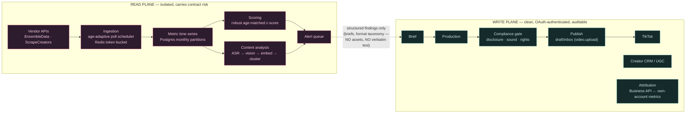
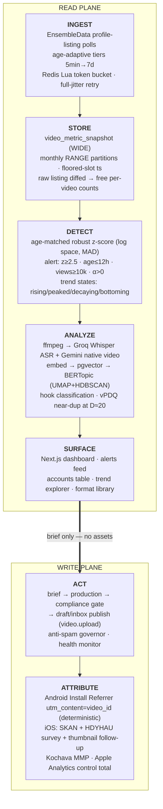

# Goodfor TikTok Machine — Architecture & Tech Stack

> Master engineering reference for the in-house TikTok intelligence + publishing + attribution system behind **Goodfor**, the team's own consumer mobile app.
> Source of truth: [`../completion.md`](../completion.md) v1.0 (6 Aug 2026). This document presents the system **in sequential build order** — how it is assembled end to end and the precise stack at every layer.
>
> Companion docs: [UI/UX direction](./UI-UX-DASHBOARD.md) · Phases [0](./phases/PHASE-0-foundations.md) · [1](./phases/PHASE-1-see.md) · [2](./phases/PHASE-2-understand.md) · [3](./phases/PHASE-3-act-publishing.md) · [4](./phases/PHASE-4-attribute.md) · [5](./phases/PHASE-5-scale-creators.md)

---

## 1. System overview & the two load-bearing constraints

Goodfor TikTok Machine is a single monorepo that does six things end to end: (1) competitor / keyword / hashtag **intelligence** on purchased data, (2) **outperformance and trend detection** with age-matched robust statistics, (3) **content-format and hook analysis** (ASR + native video understanding + clustering), (4) a multi-app **UGC creator CRM**, (5) multi-account **scheduling and publishing** to Goodfor's own TikTok accounts, and (6) **TikTok → install → signup → subscription attribution**.

Every architectural decision downstream is forced by two verified platform facts. **Do not re-litigate these** — they are checked against TikTok's own docs and are the reason the system looks the way it does.

**Constraint 1 — the only official competitor-data surface is closed to us.** TikTok's Research API is the sole official endpoint offering keyword/hashtag search plus competitor video data, and it is **categorically closed to commercial users**. Therefore *all* competitor intelligence runs on purchased third-party data (EnsembleData primary, ScrapeCreators failover). The exposure is **contract risk with TikTok, not criminal** — but it means the entire read side lives on infrastructure that must be assumed disposable.

**Constraint 2 — the product's exact shape is a named prohibited app category.** TikTok's Content Sharing Guidelines verbatim prohibit "a utility tool to help upload contents to the account(s) you or your team manages." That *is* this product. So publishing must **not** use the audit-gated Direct Post flow (`video.publish`); it routes through the **draft/inbox** flow (scope `video.upload`, not audit-gated), where a human taps publish — sidestepping the prohibited category and keeping a person in the compliance loop.

From these two facts follows **the cardinal rule of the whole system**:

> **The READ plane (competitor collection) and the WRITE plane (publishing to Goodfor's own accounts) share no compute, egress IPs, credentials, or TikTok accounts.**
>
> *(The one deliberate exception is the single Supabase Postgres that both planes persist to; isolation is enforced at the compute, egress, credential, and TikTok-account level — not at the database, which is the shared substrate the read-only dashboard reads from.)*

If the planes touch, a single scraping complaint on the read side can take down publishing and jeopardise the authenticated API client on the write side. Plane separation is, in the spec's words, "the single highest-value risk control" — cheap to build in from day one, expensive to retrofit. It is enforced physically (§2) and structurally in the schema and code layout (§4, §6).

---

## 2. Read plane vs write plane (why they are physically separated)

Two planes, isolated by a **hard boundary**: separate cloud accounts, separate egress IPs, separate credentials, separate TikTok accounts. Data crosses the boundary **only as briefs and structured findings — never competitor video files, audio, or verbatim text.** A brief says "before/after hook, question opener, 0.8s cuts, price reveal at 2s"; it never carries the source clip or a copied script.

**Why physical, not logical, separation.** The read plane is presumed to attract a ToS complaint eventually. If it shares a VPC, IP range, service account, or TikTok login with the write plane, that complaint can cascade into suspension of the authenticated Content Posting API client — killing the one thing that actually ships Goodfor's videos. Isolation caps the blast radius: worst case, the read plane goes down and gets rebuilt behind a vendor swap (the vendor abstraction exists precisely for this), while publishing, the CRM, and attribution keep running untouched.

**What may and may not cross.** Only distilled, non-copyrightable *findings* move left-to-right: the format taxonomy, hook-type distributions, "this structure is outperforming," z-scores, trend states. Never the competitor's pixels, audio, captions, or on-screen text — those stay quarantined in the read plane. This is both a legal firewall (§7 replication rule: *replicate formats, never assets*) and the mechanism that lets the write plane stay "clean" and auditable.

---

## 3. End-to-end data flow: ingest → store → detect → analyze → surface → act → attribute

**Ingest.** The read plane polls **profile listings** (not per-video snapshot endpoints) through EnsembleData on an **age-adaptive schedule**: `<1h → 5min`, `1–6h → 15min`, `6–24h → 30min`, `1–3d → 2h`, `3–7d → 6h`, `7–30d → 24h`, `>30d → 7d/evict`, with a **velocity override** (promote a tier when Δviews > 3× the prior window; demote after two polls with Δviews/views < 0.005; 5-min floor). The scheduler is a single `due_at timestamptz` column with a partial index `WHERE tracking_active`, drained by one 60-second tick with a `LIMIT` — **never one cron per video**. All egress passes a **Redis Lua token-bucket** control plane (10/sec, capacity 300 so a cold start can't starve publishing), with AWS full-jitter retry `sleep = uniform(0, min(300s, 1s×2^attempt))`, max 6 attempts, honouring `Retry-After` as a floor, and a circuit breaker (5 consecutive 429/5xx → failover to ScrapeCreators).

**Store.** Each poll's listing payload already carries play/digg/comment/share for *every* video at zero extra unit cost, so we **persist the raw listing and diff it** rather than paying for `Multiple Post Info` per video (this is the $200-vs-$800 lever, §7). Metrics land in `video_metric_snapshot` — a **wide** table (all six counters in one row), `PARTITION BY RANGE (ts)` monthly, PK `(video_id, ts)` where `ts` is the **floored slot** so `INSERT … ON CONFLICT DO NOTHING` makes at-least-once queue redelivery a no-op. `view_count` is `BIGINT`; `like/comment/share` are `INTEGER` (int32) — getting the width wrong silently truncates at 2,147,483,647.

**Detect.** For each video the scorer interpolates its view trajectory onto a fixed **age grid** `{1,2,3,6,12,24,48,72,168}` hours and computes an **age-matched robust z-score in log space** against a trailing cohort baseline of **N=30** same-age videos (50 for high-volume), using `median` and `MAD` with the `0.6745` constant (**not** 1.4826 — swapping them inverts the scale ~4.9×). It **refuses to score** when the baseline has fewer than 8 usable points. Two-window causal velocity `v` and acceleration `α` gate the alert. **An alert fires when `z ≥ 2.5 AND age ≤ 12h AND views ≥ 10,000 AND α > 0`.** Worst-case detection latency ≈ 15 min + queue lag. Keyword/hashtag series are classified into `rising | peaked | decaying | bottoming` from the velocity/acceleration sign pair.

**Analyze.** Alert-clearing and corpus videos flow into the content pipeline: `ffmpeg` extracts audio + keyframes; **Groq `whisper-large-v3-turbo`** produces transcript + word timestamps ($0.04/audio-hour); **Gemini** does native-video structured analysis (only Google of the three majors ingests native video). Transcripts embed into `pgvector` (`halfvec(1536)`, HNSW); **BERTopic** (`UMAP` → `HDBSCAN`) re-fits weekly and assigns daily in milliseconds, with HDBSCAN's `-1` outliers treated as the **"novel format" alert queue**. Hooks are classified over the first 3 seconds (dense-sampled, 12 frames) into a constrained `hook_type` enum. Near-duplicates use **vPDQ** with match distance tightened to **D ≈ 20**.

**Surface.** Findings render in the Next.js dashboard: the alerts/outperformance feed, the competitor accounts table with directional sparklines, the trend explorer, and the format/hook library. Every read-plane view carries a **data-freshness stamp** because the data is purchased and windowed. See [UI-UX-DASHBOARD.md](./UI-UX-DASHBOARD.md).

**Act.** A human triggers a brief from a finding. The brief crosses into the **write plane** (no assets, no verbatim text), gets produced, then passes a **non-bypassable compliance gate** (disclosure artefact, sound validated against `account_type`, competitor-claim review) before publishing via the **draft/inbox** flow (`POST /v2/post/publish/inbox/video/init/`, scope `video.upload`). An **anti-spam governor** enforces ≤12 posts/account/24h and ≤4 in-flight uploads, quarantining any `spam_risk_*` for 24h **without retry**.

**Attribute.** Published videos carry per-video attribution. **Android is per-video ground truth** (Play Install Referrer, `utm_content=<video_id>`, deterministic). **iOS is essentially uncovered** at the video level (SKAdNetwork/AdAttributionKit need signed ads) — so the system ships Android as ground truth and extrapolates, budgeting **60–75% of organic iOS installs as unattributable at video level**, backfilled with a post-paywall HDYHAU survey, a thumbnail follow-up, an idempotent Apple Analytics Reports API control total, and single-channel pause tests for incrementality.

---

## 4. Component map (every app + package and its responsibility)

Monorepo: **npm workspaces**, ESM (`"type":"module"`), Node ≥20, TypeScript ^5.7.2, tests in Vitest. Status reflects the current build (read-plane spine is real; Phase 2+ is scaffolding).

| Component | Plane | Responsibility | Status |
|---|---|---|---|
| `packages/scoring` | Read | Robust stats (`median`, `mad`, `modifiedZ` @ 0.6745), age-grid interpolation, causal velocity/acceleration, `scoreVideo`/`shouldAlert` (z≥2.5, ≤12h, ≥10k, α>0), trend classification, 7-tier `POLL_TIERS`. The outperformance math of §5. | **Built + tested** (390 LOC + 213 test) |
| `packages/tiktok-source` | Read | Vendor abstraction: `TikTokSource` interface, `EnsembleDataSource`, `FixtureSource`, `createSource()` factory. Cost discipline: listing-not-per-video, secUid over username. | **Built** (vendor unproven vs live API) |
| `packages/contracts` | Read | Phase-2 interface surface: `MediaProvider`, `AsrProvider`, `VisionProvider` (13-value `HOOK_TYPES` enum), `EmbeddingProvider`, `DedupeProvider` (`DEFAULT_HAMMING_DISTANCE=20`). Cost fields threaded throughout. | **Built** (interfaces only; zero implementers) |
| `packages/db` | Both | Singleton service-role Supabase client, `loadEnv`, generated `database.types.ts`. Server-only, RLS-bypassing. | **Built** |
| `packages/asr` | Read | Groq Whisper ASR provider (impl of `contracts.AsrProvider`). | **Empty shell** — `package.json` only, no `src/index.ts` |
| `packages/clustering` | Read | BERTopic (UMAP+HDBSCAN) + vPDQ dedupe. | **Empty shell** — no `src/index.ts` |
| `packages/embeddings` | Read | Text embeddings → `pgvector`. | **Orphan probe** — no `package.json`, 2-line probe only |
| `packages/vision` | Read | Gemini native-video analysis provider. | **Orphan probe** — no `package.json`, 2-line probe only |
| `apps/worker-read` | Read | Ingestion + scoring pipeline: `pipeline.ts` (slot-floored persist, age-matched scoring, alert emit), `tick.ts` (60s loop), `trends.ts`, `seed.ts`, `demo.ts`. | **Built** (686 LOC) — no Redis bucket yet; alerts console-only |
| `apps/dashboard` | Read | Next.js 15 / React 19 server-component dashboard: alerts, trends, accounts, formats; `lib/queries.ts`. | **Built** (4 pages) |
| `apps/worker-analyse` | Read | Phase-2 analysis orchestrator (ASR → vision → embed → cluster). | **Missing** — referenced by dashboard, not created |
| *write-plane worker/app* | Write | Brief gen, compliance gate, draft/inbox publisher, anti-spam governor, health monitor. | **Not started** (schema only) |
| `supabase/migrations` | Both | 4 SQL files: `init_tiktok_core` (read+write schema, monthly partitions, `halfvec` HNSW), `partition_maintenance` (pg_cron), `tracked_terms`, `analysis` (`format_cluster`, `analysis_queue`). | **Built** (376 LOC) |

---

## 5. The tech stack, layer by layer

One table per layer. Each row: **technology · version · the one reason it was chosen.** Versions are the pinned/target values; costs are carried in §7.

### Runtime & monorepo

| Technology | Version | The one reason |
|---|---|---|
| Node.js | ≥20 | Single language across workers + dashboard; native `ws`/fetch. |
| TypeScript | ^5.7.2 | Contracts (`packages/contracts`) are the integration seam between planes — types are the enforcement. |
| npm workspaces | (npm 10) | Zero-infra monorepo; no extra tool to keep the read/write package split legible. |
| ESM (`"type":"module"`) | — | Matches Next 15 / modern tooling; no dual-format build. |
| tsx | ^4.19.2 | Run workers (`tick`, `trends`, `seed`, `demo`) with no compile step. |
| Vitest | ^2.1.8 | Guards the load-bearing math (e.g. the 0.6745-vs-1.4826 inversion test). |

### Database

| Technology | Version | The one reason |
|---|---|---|
| PostgreSQL | 16 (Supabase) | Storage is a rounding error; Postgres has the lowest compute floor, the real cost driver. |
| Native declarative range partitioning | monthly | Supabase has **no TimescaleDB** (verified against the live project); native partitions give the same pruning + O(1) retention drops, no extension. |
| pgvector | `halfvec(1536)`, HNSW `m=16 ef_construction=64` | Same DB as everything else; `halfvec` is 7–9 GB at 1M vectors vs 15–24 GB float32. |
| pg_cron | — | `ensure_metric_partitions()` keeps partitions ~3 months ahead with no external scheduler. |

*Explicit rejection:* **no ClickHouse** — ClickBench runs 70× Goodfor's annual volume; Goodfor generates ~25.2M rows/year (hot query ≤14.4M), and Postgres serves it at a fraction of ClickHouse Cloud's $66–499/mo.

### Queue, cache & control plane

| Technology | Version | The one reason |
|---|---|---|
| Cloudflare Queues *or* BullMQ + Redis | current | $7 vs $531 for durable-execution platforms at this poll volume. |
| Redis (Lua token bucket) | 7.x | Global egress throttle: rate 10/sec, capacity 300 (not 600) so cold-start ingestion can't starve publishing. |
| `due_at` column + 60s tick | — | One indexed lookup per tick — **not** one cron per video (~2.07M polls/mo would be unmanageable as jobs). |

*Explicit rejection:* **no Temporal/Inngest for polling** — at 2.07M polls/mo Temporal ≈ $531 and Inngest blows its 1M-execution Pro tier 8–12×. Durable execution is right for *publishing* (few, valuable executions), wrong for high-volume low-value polling.

### Dashboard

| Technology | Version | The one reason |
|---|---|---|
| Next.js | ^15.1.3 | Server components + `force-dynamic` hit the service-role DB directly; alerting UX is bespoke (Retool at $225–475 buys the wrong thing). |
| React | ^19.0.0 | Paired with Next 15. |
| Recharts | current | Sparklines + time-series in the same React tree; no separate BI tool. |

### Workers

| Technology | Version | The one reason |
|---|---|---|
| Node/TypeScript workers on Fly.io *or* Railway | current | Matches the rest of the stack; simplest read-plane isolation boundary. |

### Read-plane data vendors

| Technology | Version | The one reason |
|---|---|---|
| EnsembleData (primary) | Bronze 5,000 units/day | Flat monthly tiers + daily allowances; listing polls return per-video counts free, keeping us inside Bronze ($200) not Gold ($800). |
| ScrapeCreators (failover) | 25,000 non-expiring credits | $1.88/1k, **zero carrying cost** — ideal circuit-breaker target on EnsembleData 429/5xx. |
| `davidteather/TikTok-Api` | MIT | The only TikTok scraper safely vendorable into closed source. |

*Explicit rejections:* **Apify not on the hot path** (pay-per-event + actor-start latency unfit for 15-min polling; use only its 93.32%-success figure to size retries). **Never build on Creative Center's internal `creative_radar_api`** (returns `40101 no permission` with an attributable `request_id` — a ToS breach *with an audit trail*).

### ASR

| Technology | Version | The one reason |
|---|---|---|
| Groq | `whisper-large-v3-turbo` | **$0.04/audio-hour** = 9.0× cheaper than OpenAI Whisper; `verbose_json` gives word timestamps (~$5/mo at 500 videos/day). |
| faster-whisper container | — | Kept **only** as a 429 breaker — do not self-host on the hot path. |

### Vision

| Technology | Version | The one reason |
|---|---|---|
| Gemini | 2.5 Flash (quality) / 3.1 Flash-Lite (optimised) | **Only** major that ingests **native video** (258 tokens/frame, 32 tokens/audio-sec); Claude is JPEG/PNG/first-frame-only. |
| Gemini Batch API | — | 50% off for the corpus lane (~420–450 videos/day); sync lane reserved for ~50–80 alert-clearing videos. **Bill audio on the audio line** ($1.00/M vs $0.30/M) or you understate cost 22–26%. |

*Explicit rejection:* **no separate OCR** (Cloud Vision = $270/mo, 17× Flash-Lite) — read on-screen text inside the Gemini call.

### LLM & embeddings

| Technology | Version | The one reason |
|---|---|---|
| OpenAI `text-embedding-3-small` | current | $0.02/M ≈ $1.20/year — a rounding error; chosen on dimension (1536), not price. |
| BERTopic (UMAP + HDBSCAN) | current | No `n_topics` knob; `min_cluster_size` = 0.5–1% of corpus; `prediction_data=True` → weekly re-fit, millisecond daily assignment. |
| vPDQ | D ≈ 20 | Variable-length hash matches trimmed/cropped reposts (TMK can't); D≈20 separates "same creator reposting" from "different creator recreating the format" — the actual signal. |
| Gemini 2.5 Flash (cluster labels) | — | Labels ~50 clusters/week for ≈ $0.05/week. |

### Publishing APIs

| Technology | Version | The one reason |
|---|---|---|
| TikTok Content Posting API — **draft/inbox** | `POST /v2/post/publish/inbox/video/init/`, scope `video.upload` | **Not audit-gated**; sidesteps the prohibited-app category (a human taps publish) — the load-bearing write-plane choice (§1, Constraint 2). |
| TikTok `creator_info/query` | v2 | Called first on **every** post — returns allowed privacy levels, Duet/Stitch/Comment settings, `max_video_post_duration_sec`. |
| Postiz (self-hosted) | AGPL-3.0 | 34k-star Next.js+Redis publisher; fine run **unmodified internally**. **AGPL warning:** forking into anything customer-facing triggers network copyleft — use **Mixpost (MIT)** instead. |

*Do not use Direct Post (`video.publish`)* for the internal tool — it is audit-gated and the audit rejects this exact product category.

### Attribution & MMP

| Technology | Version | The one reason |
|---|---|---|
| Play Install Referrer | `com.android.installreferrer:installreferrer:2.2` | **Android = per-video ground truth, free, 100% deterministic** via `utm_content=<video_id>`. |
| SKAdNetwork / AdAttributionKit | current | The only iOS surfaces — and they need *signed ads*, so organic stays uncovered (budget 60–75% iOS installs unattributable at video level). |
| Kochava (MMP) | Free tier | 10K attributed conversions/mo, owned-media + SmartLinks, **$0**; graduate to Tenjin (~$2,200) only when volume demands. |
| Apple Analytics Reports API | current | Daily channel **control total**; load idempotently re-keyed on `(date, processing_date)`. |
| TikTok Business API | v2 | Own-account metrics + Spark Ads linking (write plane only). |

*Trap:* fronting organic traffic with an MMP link converts free organic into **billable** conversions — keep MMP on owned-media/SmartLinks only.

### Hosting & infra

| Technology | Version | The one reason |
|---|---|---|
| Supabase | Postgres 16 project | Managed Postgres + pg_cron + generated types; the DB *is* the platform. |
| Fly.io / Railway | current | Worker hosting that keeps the read plane a clean isolation boundary from the write plane. |
| Cloudflare | current | Queues + egress; cheapest durable queue at this volume. |
| KMS-wrapped token storage | — | Write-plane OAuth tokens stored `bytea`, KMS-wrapped, refreshed under advisory lock (refresh-token race loses accounts permanently otherwise). |

---

## 6. Data model summary

Tables split cleanly by plane; the split is a schema-level enforcement of §2. Full DDL in [`supabase/migrations/`](../supabase/migrations/).

**Read plane.** `competitor_account` (`platform_user_id` UNIQUE, cached `sec_uid` for cheaper polling) → `tracked_video` (`due_at`, `tracking_active`, partial index on `due_at WHERE tracking_active` — the scheduler hot path) → **`video_metric_snapshot`** (the core table) → `video_score` (`z_score`, `multiplier_vs_median`, `velocity_vph`, `acceleration`, `baseline_n`) → `video_analysis` (`transcript`, `hook_type`, `embedding halfvec(1536)` HNSW, `phash_frames bytea`). Trend series live in `keyword_trend` (`state ∈ rising|peaked|decaying|bottoming`) keyed to `tracked_term`; clustering outputs land in `format_cluster` (id `-1` = the HDBSCAN outlier / "novel format" bucket) and `analysis_queue`.

**Write plane.** `owned_account` (`account_type ∈ business|creator` — **gates sound selection at brief time**; tokens `bytea` KMS-wrapped; `original_granted_at` drives the re-auth prompt) → `scheduled_post` (`disclosure_verified bool` **non-bypassable**; `sound_is_cml bool`; `publicaly_available_post_id` — TikTok's misspelling, kept verbatim in code) → `account_health` (`strike_count_by_area jsonb`, `fyf_traffic_share`, `suppression_flag`). Attribution and creator-CRM tables (§9/§10) are **not yet built** — the current schema stops at the write-plane publishing tables.

**Why raw-listing persistence.** Profile-listing polls already return play/digg/comment/share for every video at **zero extra unit cost**. Persisting the raw listing payload and **diffing it** yields ~9,000 free samples/day (~1,400 units/day, inside Bronze $200) instead of paying `Multiple Post Info` (2× #posts) — the difference between a $200 and an $800 vendor bill. This is why the schema stores snapshots keyed on the *listing*, not per-video metric pulls.

**Why partitioning (and the six design rules).** `video_metric_snapshot` is **WIDE not EAV** (all six counters in one row — EAV would 6× the rows and force a self-join per velocity query), `PARTITION BY RANGE (ts)` **monthly** (pg_cron keeps 3 months ahead; retention is an O(1) partition drop), with **correct integer widths** (`view_count BIGINT`, others `INTEGER`) and **floored-slot `ts`** so `ON CONFLICT (video_id, ts) DO NOTHING` gives free idempotency under at-least-once delivery. Two further rules: **never `UPDATE` metrics** (append-only history), and **`account_type` gates sound at brief time** (a Business account can't use trending sounds; a Creator account can't publish via API — enforced in schema, not code comments).

---

## 7. Cost envelope

Monthly, by phase. Data acquisition **dominates every scenario** and is controlled by the listing-derived-metrics and hot-tier-cadence choices above. Figures from §13.

| Layer | Phase 0–1 (floor) | Phase 1–4 (expected) | Phase 5 (+creators) |
|---|---|---|---|
| **Read plane** (data acquisition) | $200 | $400 | $1,300 |
| **AI** (ASR + vision + embeddings + labels) | $21 | $120 | $750 |
| Storage + DB | $30 | $70 | $160 |
| Compute + queue | $7 | $110 | $850 |
| Dashboard | $0 | $80 | $475 |
| **Publishing** | $15 | $49 | $299 |
| **Attribution / MMP** | $0 | $0 | $2,200 |
| Observability | $18 | $41 | $100 |
| **Total** | **$291** | **~$870** | **~$6,134** |

The **Phase 0–1 (floor)** column is the initial monthly minimum (it carries small early-testing lines for AI and publishing sandboxes); §9 and [`PHASE-1-see.md`](./phases/PHASE-1-see.md) quote **~$400** as the Phase 1 *operating* cost once account coverage and poll cadence ramp. Modash discovery adds **+$2,183/mo in Phase 5 only** (the single largest discrete commitment, $16,200/yr Discovery API). AI cost has a **~30× spread** ($56 optimised → $1,615 naive) that is *entirely* model + batching choices (3.1 Flash-Lite + 85% batched vs Opus 5 sync). **Buying instead of building** (Exolyt-class bundles $1,430–2,850/mo) costs 1.6–3× more *and* can't deliver the three capabilities that justify the system: 15-min-cadence age-matched robust-z alerting, format clustering, and the TikTok→install→subscription join.

---

## 8. Non-negotiable engineering rules

These are load-bearing. Violating any one silently corrupts the output or the risk posture.

1. **Median, not mean.** Baselines use `median`/`MAD`, never mean/SD. A mean baseline suffers **masking** — an account posting several virals inflates its own mean until nothing registers as an outlier. (`packages/scoring`, guarded by the 0.6745-vs-1.4826 test.)
2. **Age-matched.** Compare a video only against same-age videos: interpolate onto the fixed age grid `{1,2,3,6,12,24,48,72,168}h` and baseline against a trailing cohort at that same age. Comparing raw totals across ages is meaningless on a heavy-tailed distribution.
3. **Causal window.** Velocity and acceleration use two **past** windows only (`v = ΔV/Δt`, `α = Δv/Δt`). No future data, no centered smoothing — the detector must be honest about what was knowable at detection time.
4. **Listing-not-per-video.** Persist and diff raw profile-listing payloads for per-video counts; reserve paid per-video endpoints for exceptions. This is the $200-vs-$800 cost line.
5. **Plane separation.** Read and write share **no** infrastructure, credentials, egress IPs, or TikTok accounts. Only briefs/findings cross — never assets or verbatim text.
6. **Draft/inbox publishing.** Publish via `video.upload` (draft/inbox), never `video.publish` (audit-gated Direct Post). A human taps publish; this sidesteps the prohibited-app category.
7. **Disclosure-in-the-gate.** The disclosure artefact (burned-in "Ad" first frame + spoken disclosure + leading "#ad") is a **non-bypassable, region-aware** field on `scheduled_post`, storing which TikTok toggle was used + a `post_time+24h` appeal SLA. It clears FTC ($53,088/violation) *and* UK ASA/CMA (up to 10% turnover) in one artefact.

Two structural corollaries also hold without exception: **never `UPDATE` a metric row** (append-only), and **`account_type` gates sound selection at brief-generation time** (Business ⇒ Commercial Music Library only + API publishing; Creator ⇒ trending sounds + Creator Rewards but no API publishing — you cannot have both on one account).

---

## 9. Build sequence

Six phases, gated by explicit exit criteria. Detail per phase in the linked docs.

- **[Phase 0 — Foundations](./phases/PHASE-0-foundations.md)** (weeks 1–2, ~$250/mo). Prove the data before fixing the schema: run the **vendor bake-off** (same 100 videos through EnsembleData/ScrapeCreators/Apify within one hour, measure view/like/comment/share disagreement), get **named legal sign-off** on §11, register the TikTok app, and **submit the Accounts API Access Application Form** (blocking since 20 Mar 2026 — start week 1). *Exit: signed risk acceptance, chosen vendor with measured accuracy, form submitted.*
- **[Phase 1 — See](./phases/PHASE-1-see.md)** (weeks 3–6, ~$400). Ingestion with age-adaptive polling + Redis token bucket, the wide snapshot table, robust age-matched z-score, the alert queue (`z≥2.5, age≤12h, views≥10k, α>0`), and a basic Next.js dashboard. **Instrument the real poll count in week 1** — the ~69k/day derivation doesn't reconcile with the tier table, so measure, don't budget. *Exit: alerts firing within 15 min, measured false-positive rate.*
- **[Phase 2 — Understand](./phases/PHASE-2-understand.md)** (weeks 7–10, ~$500). Groq ASR, Gemini two-lane vision (sync + Batch), pgvector embeddings, weekly BERTopic re-fit + daily `approximate_predict`, hook classification, vPDQ at D≈20 — plus the missing `apps/worker-analyse` orchestrator. *Exit: format taxonomy + hook-type distribution with per-type performance.*
- **[Phase 3 — Act](./phases/PHASE-3-act-publishing.md)** (weeks 11–14, ~$600). Brief generation, the non-bypassable compliance gate (disclosure, sound vs `account_type`, competitor-claim review), draft/inbox publishing, the anti-spam governor, account-health monitoring, and the **own audit submitted in parallel** (day one). The new Branded Content Policy takes effect 31 Aug 2026 mid-phase — build to it. *Exit: detect→brief→produce→gate→publish within one working day.*
- **[Phase 4 — Attribute](./phases/PHASE-4-attribute.md)** (weeks 15–18, ~$700). Android Install Referrer per-video `utm_content`, per-account bio links with a rotation log, HDYHAU post-paywall + thumbnail follow-up, the idempotent Apple Analytics control total, Custom Product Pages → formats, and the first single-channel pause test. *Exit: a defensible organic CPI from an incrementality test.*
- **[Phase 5 — Scale creators](./phases/PHASE-5-scale-creators.md)** (weeks 19–24, ~$2,000). Modash discovery (capture `credibility` at search time — it's query-time-only), the collaboration-level CRM, outreach (DM first, email day 2/5), rights + payment tracking with `licence_end` alerting, and Spark Ads via Business Center linking. *Exit: creators sourced→contracted→delivering→attributed, with no expired licences live.*

---

## 10. Dashboard UX direction

The dashboard is the read plane's only human surface, so its job is fast triage across six tables — analytics overview, the realtime outperformance feed, the multi-account content calendar, the creator CRM pipeline, the competitor accounts table with sparklines, and the keyword/hashtag trend explorer. Standardise five cross-surface conventions everywhere: a global date/scope control top-right, signed red/green deltas beside every metric, directional-coloured sparklines, consistent severity/status chips, and — because this plane runs entirely on purchased, windowed data — a **"last updated" freshness stamp on every read-plane view**. Full reference-backed layout guidance (Amplitude/Stripe overview, incident.io alert feed, Sprout Social calendar with the draft/ghost card, Pipedrive/Juicebox CRM board, Reddit Ads sparkline table, Pinterest Trends explorer) is in **[UI-UX-DASHBOARD.md](./UI-UX-DASHBOARD.md)**.
