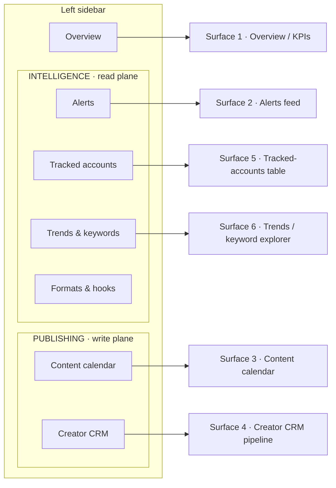

# Goodfor TikTok Dashboard — UI/UX Spec

> Operator console for the Goodfor TikTok Machine. Reference architecture: [`./00-ARCHITECTURE.md`](./00-ARCHITECTURE.md). This spec covers the six operator surfaces and how the existing Next.js dashboard (`apps/dashboard`) should evolve into them across [Phase 1](./phases/PHASE-1-see.md) → [Phase 5](./phases/PHASE-5-scale-creators.md).
>
> Every Mobbin reference below links to a specific screen. They are the visual source of truth — clone structure, not chrome.

---

## Design principles

This is an **operator tool**, not a marketing dashboard. One or two analysts stare at it for hours, triaging alerts and pushing drafts. Optimise for scanning speed and information density, not for onboarding delight.

1. **Density over whitespace.** The current tables already do this well — 13px monospace numeric columns, 11px uppercase headers, tight `13px 16px` cell padding. Keep that. A row should carry a full decision's worth of data without a click. Reserve click-through for drill-downs (anomaly timeline, creator profile), never for basic facts.

2. **Dark-mode-first.** The current stylesheet is *light-first* with a `@media (prefers-color-scheme: dark)` fallback (`apps/dashboard/app/globals.css`). **Flip this.** An alerting console gets left open on a second monitor overnight; dark is the default working state. Define the dark palette on `:root`, derive light as the override. Keep the burnt-orange accent (`--accent: #f0784a` in dark) — it is distinctive and reads as "TikTok-adjacent without cloning TikTok's cyan/magenta."

3. **The number is the UI.** Severity, direction, and freshness must be legible pre-reading. Use the existing `.z` hot/warm/cool colour ramp, signed red/green deltas, and directional sparklines so an analyst resolves "is this worth my attention" from colour and shape before parsing a single digit. Convention A from §5 is the ramp: **2× noteworthy, 3× significant, 5× viral candidate, 10× exceptional** — the current `zClass()` (`z≥10` hot, `z≥5` warm, else cool) already encodes it; standardise those thresholds everywhere.

4. **Freshness is a first-class metric.** The entire read plane runs on **purchased EnsembleData / ScrapeCreators** windows, not live data (the Research API is closed — see [`./00-ARCHITECTURE.md`](./00-ARCHITECTURE.md)). A stale poll silently invalidates every z-score. Put a Stripe-style **"Updated HH:MM"** stamp on every read-plane surface, sourced from `competitor_account.vendor_last_synced_at` / the latest `keyword_trend.ts`. Never render read-plane data without it.

5. **The read/write plane split is a UI convention, not just an infra one.** The two planes never share credentials, egress IPs, or TikTok accounts. The dashboard is a **read-only console over the shared Supabase Postgres**, so it legitimately shows both — but it must *label* which plane an operator is looking at, so no one confuses a competitor-intelligence view with a publishing action. Make the plane boundary visible in navigation (below) and never place a "publish" control on a read-plane surface.

6. **Colour is never the only signal.** Red/green sparklines and severity chips must be paired with a sign (`+`/`−`), an arrow, or the raw z-number, so the surface survives colour-blindness and greyscale printing. (Detail in [Accessibility](#accessibility--performance-notes).)

---

## Global layout & navigation

Evolve from the current horizontal top-nav (`layout.tsx`: Alerts / Trends / Formats / Accounts) to a **persistent left sidebar** grouped by plane. A sidebar scales to the six surfaces + secondary views without the top bar overflowing, keeps the active section visible during deep scrolling, and is the natural place to make the plane boundary explicit.



Sidebar rules:

- **Two labelled groups**, `INTELLIGENCE` (read plane) and `PUBLISHING` (write plane), with a hairline divider and a muted plane tag. This is the visible expression of design principle 5. `Formats & hooks` (the existing `/formats` page) lives under INTELLIGENCE as a secondary read-plane view; it is not one of the six core surfaces but must remain reachable.
- **Global controls pinned top-right of every surface:** a date/scope selector and — on read-plane surfaces — the freshness stamp. This mirrors Amplitude/Stripe, where one scope control at top drives every widget on the page.
- **Active item** uses the existing `box-shadow: inset … var(--accent)` treatment, moved from a bottom border to a left border for the vertical rail.
- **Unread/attention counts** ride on the nav item itself — an amber count on `Alerts` for unacknowledged outperformers, a red count on `Creator CRM` for creators with a `licence_end` inside 14 days. The sidebar becomes the triage index.

Content column stays the current centred `max-width` shell for reading-oriented surfaces, but the **table and calendar surfaces should widen to fill** (competitor tables and month grids need the horizontal room). Provide an `overflow-x: auto` wrapper on every table so a wide column set never scrolls the page body.

---

## Surface-by-surface spec

Each surface below gives: **purpose**, **key components**, a **layout sketch**, the **Mobbin references**, and **do / don't** notes grounded in the spec.

---

### 1 · Overview / KPIs — the attribution home

**Purpose.** The landing surface. Answers "is the whole machine working?" in one screen: the **TikTok → install → signup → subscription** funnel (§10), plus a roll-up of read-plane activity (alerts firing, accounts tracked, corpus analysed). This is primarily a **write-plane / attribution** surface — most metrics come from own-account data and the MMP, with a read-plane sidebar of counts.

**Key components.**
- A single-row **KPI stat strip** directly under the scope control: five cards — **impressions · profile clicks · installs · signups · paid subs** — each showing value + signed period-over-period delta (red/green), evolving the existing `.stat` block which today shows only a raw number and label.
- One **hero time-series**: installs/day (Android = per-video ground truth via Play Install Referrer; the hero chart is where the deterministic Android line and the extrapolated-iOS band both render — label the iOS portion as estimated, since **60–75% of organic iOS installs are unattributable at video level**).
- A **supporting small-multiples grid** beneath: installs-by-format (Custom Product Pages → formats), signup→paid conversion, top-performing videos by attributed installs.
- Freshness stamp + "attribution has a 15-min deferred-deeplink lookback / privacy floor omits <5 users" caveat line, so nobody over-reads a thin day.

**Layout sketch.**
```
┌───────────────────────────────────────────────── scope: Last 7d ▾   Updated 06:23 ┐
│  IMPRESSIONS   PROFILE CLK    INSTALLS     SIGNUPS      PAID SUBS                   │
│  1.2M  +8.4%   38.1K +12%     742  −3.1%   410  +5.0%   118  +9.2%                  │
├────────────────────────────────────────────────────────────────────────────────── │
│  Installs / day  (Android deterministic ▬  ·  iOS estimated ▒)                      │
│  ▁▂▃▅▆▇▇▆▅▆▇█  ← hero                                                                │
├──────────────────────────┬──────────────────────────┬────────────────────────────── │
│  Installs by format      │  Signup → Paid            │  Top videos by installs      │
│  (small multiple)        │  (small multiple)         │  (mini table)                │
└──────────────────────────┴──────────────────────────┴────────────────────────────── │
```

**Mobbin references.**
- [Amplitude — Web Engagement overview](https://mobbin.com/screens/dc112aff-0eda-4659-8447-9c88b516b2d1) — the closest template: scope selector → KPI strip with signed deltas → one hero time-series → secondary tiles.
- [Stripe — "Your overview"](https://mobbin.com/screens/02176a39-e453-4570-af73-6af00fbe681b) — the "Last 7 days compared to Previous period" comparison control driving every widget, and the **"Updated 06:23" freshness stamp** to adopt across the read plane.
- [AWS — CloudWatch Metrics grid](https://mobbin.com/screens/155f6723-985c-49ea-bd6e-9838fffe0ddb) — the dense equal-weight small-multiples grid; **reserve this for a secondary "all metrics" tab, not the landing page.**

**Do.**
- Keep the hero chart to **one metric**. Resist AWS-grid density on the entry screen.
- Split Android (deterministic) from iOS (estimated) visually and never sum them into one unlabelled "installs" figure — that would launder an estimate as ground truth.
- Drive every tile from the single top scope control.

**Don't.**
- Don't front organic links with an MMP tracking link just to populate this screen — it **converts free organic into billable MMP conversions** (§10 trap).
- Don't show a per-video iOS attribution number as if it were exact; it is extrapolated.

---

### 2 · Alerts feed — realtime outperformance detection

**Purpose.** The read-plane workhorse (§5). Surfaces competitor videos beating their own account's age-matched baseline while still accelerating. The alert rule is fixed: **`z ≥ 2.5 AND age ≤ 12h AND views ≥ 10,000 AND acceleration > 0`** (`DEFAULT_ALERT` in `packages/scoring`). Sorted by how far outside normal a video is, not by raw views.

**Key components.**
- **Filter + search bar** top: `Search alerts` (by term / handle) left, `Add filter` + `Customise view` right — analysts filter by tracked term and severity constantly.
- **Severity-sorted row list.** Each row: `{unread dot · video thumbnail · anomaly-type chip ("3× median velocity") · z-score/severity badge · source tracked_term/hashtag · account handle · detected-at (relative)}`. The unread dot + severity chip carry the scan weight. Reuse the existing `.z` ramp for the badge and `.pill` for the anomaly-type chip.
- **Click-through drill-down**: a vertical anomaly timeline — velocity samples, the moment z crossed threshold, which `tracked_term` fired, the baseline size (`baseline_n`). Relative timestamps in the feed, absolute on hover/detail.

**Layout sketch.**
```
┌ Search alerts…           [Add filter ▾] [Customise view ▾]   Updated 06:23 ┐
├────────────────────────────────────────────────────────────────────────── │
│ ● [◧] URGENT  z 11.4  ×12.1   #skincareroutine   @rivalbrand      4m ago   │
│ ● [◧] SIG     z  6.2  × 4.8   keyword:"cerave dupe" @dupehunter   18m ago   │
│   [◧] NOTE    z  3.1  × 2.4   #morningroutine   @glowlab          52m ago   │
│   … sorted by z desc, unread dot at row-left, red reserved for URGENT      │
└────────────────────────────────────────────────────────────────────────── │
  click row → timeline: 10:02 first sample · 10:31 crossed z=2.5 · α still + │
```

**Mobbin references.**
- [incident.io — Alerts list](https://mobbin.com/screens/91cca104-910b-49b5-b280-2ed7738259f6) — the strongest structural match: table rows with a coloured severity chip, an Alert-Source column with a source icon, and a red unread dot at row-left. Keep the `Search alerts` box + `Add filter`/`Customise view` controls.
- [Better Stack — incident timeline](https://mobbin.com/screens/7795f66a-1d4e-4964-a3fe-1cad5c2a735f) — the drill-down: a vertical timeline with right-aligned absolute timestamps and an inline expandable note block. Use for the per-anomaly investigation view.
- [Deel — Activity Feed](https://mobbin.com/screens/9c9ca12e-bf5c-4c93-8630-508e19ded346) — the lightweight grouped pattern (leading category icon, bold headline, one-line description, relative timestamp, `Today` header, `Mark all as read`).

**Do.**
- **Enforce the full alert rule in the query.** The current `getAlerts()` in `lib/queries.ts` filters `z≥2.5`, `age≤12h`, `acceleration>0` but **omits the `views ≥ 10,000` noise floor** that `shouldAlert()` enforces — so the dashboard's "live alerts" count is looser than what the worker would fire on. Add `.gte('view_count_at_age', 10000)` (or equivalent) so the feed and the worker agree.
- Reserve **red strictly for the highest severity** (`z ≥ 10`, exceptional) so it stays meaningful. Amber for significant, muted for noteworthy.
- Use relative timestamps in the feed (`4m ago`), absolute on hover — matches the existing `ago()` helper.

**Don't.**
- Don't sort by raw views — the whole point of the robust z (median-not-mean, §5) is to beat masking; a view-sorted feed re-introduces it.
- Don't page competitor **video files** into this surface — cross-plane data flows carry "briefs and structured findings only." Thumbnails from the vendor payload are fine; do not build a competitor-video player.
- Don't let the feed be the only alert sink. Today alerts are ephemeral `console.log` in the worker — this surface is the delivery mechanism, so it must not silently drop rows on refresh; back it with a persisted `video_score` query (already the case).

---

### 3 · Content calendar / scheduler — write-plane publishing

**Purpose.** Multi-account scheduling for Goodfor's **own** TikTok accounts (§8). Publishing routes through the **draft/inbox flow** (`video.upload` scope, *not* the audit-gated Direct Post `video.publish`) — a human taps publish in the TikTok app, which sidesteps the prohibited "multi-account uploader" app category. The calendar must make "this is a draft that still needs a human tap" unmistakable. See [`./phases/PHASE-3-act-publishing.md`](./phases/PHASE-3-act-publishing.md).

**Key components.**
- **Filter row**: `Accounts ▾ / Post Types ▾ / Publishing status ▾` with `Clear All`, a `List / Week / Month` segmented toggle, and `Today`/prev/next nav. The **account filter is load-bearing** given multi-account scheduling; **`Publishing status` is a first-class filter**: `Draft → In inbox → Published → Failed`.
- **Post cards in day cells**: network icon, scheduled time, thumbnail, and a **status treatment that reads at a glance**. Critically: a **dashed-border / ghost card = a Draft not yet pushed to the TikTok inbox** (the write plane's `video.upload` state), distinct from a solid card = scheduled/in-inbox, and a coloured status pill for Published (green) / Failed (red).
- **Week / time-of-day grid** (7AM–11PM rows) as the precise-slot view when timing matters.
- **Compliance surfacing on the card**: a small badge when the non-bypassable disclosure gate is satisfied (`scheduled_post.disclosure_verified`) and when sound is CML-validated against `account_type` (`sound_is_cml`). A card that fails the gate cannot be dragged to a live slot.

**Layout sketch.**
```
┌ Accounts: All ▾  Post Types ▾  Status: All ▾  [Clear All]   [List|Week|Month]  ‹ Today › ┐
├──────┬──────┬──────┬──────┬──────┬──────┬──────┤
│ Mon  │ Tue  │ Wed  │ Thu  │ Fri  │ Sat  │ Sun  │
│┌────┐│      │┌────┐│      │┌╌╌╌╌┐│      │      │   ┌────┐ solid  = in inbox / scheduled
││●9a ││      ││●2p ││      │┆●5p ┆│      │      │   ┌╌╌╌╌┐ dashed = DRAFT (not pushed)
││▣pub││      ││▣sch││      │┆▣drf┆│      │      │   ▣pub green · ▣fail red pill
│└────┘│      │└────┘│      │└╌╌╌╌┘│      │      │
└──────┴──────┴──────┴──────┴──────┴──────┴──────┘
```

**Mobbin references.**
- [Sprout Social — publishing calendar](https://mobbin.com/screens/306933c0-a8f8-4554-93ab-6517fe4df1c2) — **the reference to clone**: Profiles / Post Types / Tags filters + `Clear All`, List/Week/Month toggle, and the **dashed-border card** to adopt for a not-yet-pushed draft.
- [Hootsuite — Planner with export](https://mobbin.com/screens/fcb9a7cc-9ae1-4ee7-87b6-acf74e33e7c7) — the per-post state pill on the card (green "Published") and an `Export as PDF/CSV` menu for sharing the plan.
- [Later — weekly time-grid](https://mobbin.com/screens/7fb61612-cb90-40bb-968d-7bb1989ca12a) — the vertical time-of-day grid (7AM–11PM) for precise slot timing, with "Auto" posting markers.

**Do.**
- **Distinguish Draft vs In-inbox vs Published vs Failed purely by card treatment** (border style + pill colour), so state reads without hovering. Dashed = draft is the single most important visual convention here.
- Keep the **account filter** and **Publishing status** as first-class filters (the HubSpot social-calendar vocabulary — All accounts / status — confirms this set).
- Respect the **anti-spam governor** in the UI: cap at **12 posts/account/24h**, warn at 4 in-flight uploads/account, and grey out slots for any account in `spam_risk_*` 24h quarantine. Do **not** offer a "retry" button on a quarantined account — retrying escalates toward a permanent ban.

**Don't.**
- Don't render a one-click **Direct Post / auto-publish** control. The product ships the draft/inbox path precisely to avoid the audit-gated, prohibited-category flow; a "publish now to account" button on a grid *is* the prohibited multi-account-uploader shape.
- Don't let a card reach a live/scheduled slot with `disclosure_verified = false` or an `account_type`-invalid sound — the gate is non-bypassable and region-aware (FTC $53,088/violation; CMA up to 10% turnover).

---

### 4 · Creator CRM pipeline — UGC outreach

**Purpose.** Track UGC creator collaborations across multiple Goodfor apps from sourcing to paid (§9). The CRM **models the collaboration, not the creator** — the entity that moves through stages `sourced → qualified → contacted → replied → negotiating → contracted → delivered → live` (terminal: `paid | renewed | archived | rejected`). See [`./phases/PHASE-5-scale-creators.md`](./phases/PHASE-5-scale-creators.md).

**Key components.**
- A **kanban board** with labelled stage columns, each header showing a **count + aggregate** (e.g. committed spend). A board / list / forecast view switcher and a `Sort by` control top-left.
- **Collaboration cards** with the "contact card" anatomy: creator name/handle, an **owner avatar**, a **last-touch recency line** ("Updated today"), an **app/brand tag chip** (multi-app), and a **stale-activity warning triangle** for creators who've gone quiet. Key on `platform_user_id`, never username.
- **Per-column `+ New`** inline add.
- A **rights/licence strip** on contracted+ cards: `licence_end` with an alert state when it falls inside the warning window — a live paid ad on an expired licence is the single largest routine legal exposure. This is the source of the red count on the sidebar `Creator CRM` item.

**Layout sketch.**
```
[Board|List|Forecast]   Sort: Last touch ▾   Filter: App = all ▾
┌ Sourced ─────┐┌ Contacted ───┐┌ Negotiating ─┐┌ Contracted ──┐┌ Live ────────┐┌ Paid ───┐
│ 24 · —       ││ 11 · —       ││ 6 · $1,080   ││ 4 · $720     ││ 3 · $540     ││ 9 ·$1.6k│
│┌───────────┐ ││┌───────────┐ ││┌───────────┐ ││┌───────────┐ ││┌───────────┐ │└─────────┘
││@creatorA  ⚠││││@creatorB  ││││@creatorC   ││││@creatorD   ││││@creatorE  🔴││
││[Goodfor]  ││││[App2]     ││││[Goodfor]   ││││[Goodfor]   ││││licence 9d  ││
││◔ Jas · 2d ││││◔ Jas · 5h ││││◔ Sam · 1d  ││││◔ Sam ·today││││◔ Jas ·today││
│└───────────┘ ││└───────────┘ ││└───────────┘ ││└───────────┘ ││└───────────┘ │
└──────────────┘└──────────────┘└──────────────┘└──────────────┘└──────────────┘
  ⚠ stale (no touch) · 🔴 licence_end inside window · [App] multi-app tag · ◔ owner + last touch
```

**Mobbin references.**
- [Pipedrive — Deals kanban](https://mobbin.com/screens/2ff3c977-7902-48b5-8361-0c89710e5c2e) — the canonical outreach pipeline: labelled stage columns with a **per-column count + aggregate value** header, a board/list/forecast switcher, `Sort by`, and **per-card stale-activity warning triangles**.
- [Juicebox — contacts board with stage columns](https://mobbin.com/screens/0c03339a-adfd-4ceb-81c2-d55c869b320f) — the most on-point because it is *contacts, not deals*: the **logo + owner avatar + "Updated today" last-touch** card anatomy a creator card needs.
- [Twenty — Companies board](https://mobbin.com/screens/b4ca148d-0555-4928-877c-8f2ee3115856) — the richer card (icon-prefixed metadata rows) and colour-coded column headers, plus per-column `+ New` inline-add, for a denser creator profile card.

**Do.**
- Give every card a **last-contacted timestamp and a stale flag** — those two drive daily triage. Outreach cadence is DM first touch, follow up **day 2 and day 5**, terminal at day 28; surface which step a creator is on.
- Put a **committed-spend aggregate** in each stage header so the pipeline reads as money, not just a card count. Plan pricing at **$150–$200/video** (Collabstr: UGC ask $180, paid $154 ≈ 86% of ask — do **not** encode "50% of ask").
- **Alert on `licence_end`**; a `rights_grant` must exist in v1. The stale-flag and the licence-expiry flag are the two triage drivers.

**Don't.**
- Don't key cards on username (creators rename); key on `platform_user_id`. Don't **UPDATE** creator metrics in place — append and stamp vendor provenance (capture Modash `credibility` at shortlist time; it is query-time-only and never returned again).
- Don't collapse the multi-app dimension — the CRM is multi-app; the brand tag chip is not optional.

---

### 5 · Tracked-accounts table — competitor tracking with sparklines

**Purpose.** The competitor account roster under active polling (§5/§6). Evolves the existing `/accounts` page (`getAccounts()` → `competitor_account` where `is_tracked`). Metrics are **derived from profile-listing payloads**, not per-video calls — the listing already carries every video's counts, keeping the data bill ~4× lower (§4.2).

**Key components.**
- A **KPI sparkline-card row** on top (portfolio-level): tracked accounts, videos under tracking, snapshots/day, alerts fired 7d — each card embedding a **mini sparkline** (evolving the current flat `.stat`).
- A **sortable table** with row-select (checkbox), per-column sort, a per-row overflow menu, a `Columns` customiser, `Add filter` chips, and a **Totals / median footer** (median matters — §5 is median-not-mean throughout).
- A **directional-coloured sparkline column** (last column, green/red by trailing direction) so an analyst spots which accounts are accelerating without reading numbers, plus **signed change cells**.
- A **compact range bar** for follower / velocity spread (min–max with a marker) and a **star-to-pin** for priority competitors.
- Freshness stamp from `vendor_last_synced_at` (the current page already renders per-row "Last poll" via `ago()` — keep and promote it).

**Layout sketch.**
```
┌ ACCOUNTS 42 ▁▂▃  VIDEOS 3.1k ▂▃▅  SNAPSHOTS/d 9.0k ▅▆▇  ALERTS 7d 18 ▃▂▅ ┐   Updated 06:23
├────────────────────────────────────────────────────────────────────────────────────────
│ ☑ ★ Account       Followers   1d      7d      Videos   Last poll   Velocity trend        │
│ ☑ ★ @rivalbrand   412,000    +2.1% ▲  +9.4% ▲  128      4m ago     ▁▂▃▅▇  (green)         │
│ ☑ ☆ @dupehunter    88,300    −0.4% ▼  +1.2% ▲   61      12m ago    ▇▆▅▃▂  (red)           │
│ ☑ ☆ @glowlab       15,900    +0.0%    −3.1% ▼   40      1h ago     ▃▃▂▂▁  (red)           │
├────────────────────────────────────────────────────────────────────────────────────────
│ TOTALS / median   88,300     —        —        61(med)  —          —                     │  ← footer
└────────────────────────────────────────────────────────────────────────────────────────
```

**Mobbin references.**
- [Reddit Ads — campaigns table + KPI sparkline cards](https://mobbin.com/screens/a143e291-5875-4bc3-9883-814a3f65644b) — the best combined pattern: KPI stat-cards with embedded mini sparklines above a sortable table with row checkboxes, `Columns` customiser, `Add Filter` chips, and a **Totals summary row**.
- [Uniswap — tokens table with volume sparklines](https://mobbin.com/screens/e39f0d0f-bed1-49ff-92e0-c53d36d34de6) — the cleanest **in-row directional sparkline** (green/red by direction) with sortable numeric columns and signed-change cells.
- [OKX — rankings with range bars + sparklines](https://mobbin.com/screens/6bc442d5-e94f-445b-9e86-97ebba0c2b2e) — the compact **24h range bar** (min–max marker) for follower/velocity spread and **star-to-watchlist** per row.

**Do.**
- Make the **trend column colour-coded and the change cells signed** — those carry the scan. Add a **Totals/median footer** (median, per §5's whole philosophy).
- Keep the freshness stamp prominent; purchased data going stale is invisible without it.
- Let the analyst **star-to-pin** priority competitors to the top.

**Don't.**
- Don't add a per-video-metric column that triggers `Multiple Post Info` (`2 × #posts` units) — it forces the $200→$800 tier jump. Derive the sparkline from persisted listing snapshots (`video_metric_snapshot`), which are effectively free.
- Don't mix engagement denominators in one leaderboard — **`er_views` (median 4.20%) and `er_followers` (2.60%) are different metrics** (§5.3); if both are shown, label each column explicitly.

---

### 6 · Trends / keyword explorer — purchased-data trend detection

**Purpose.** Rank and drill into tracked keywords/hashtags (§5.3). Evolves the existing `/trends` page (`getTrends()` → `keyword_trend`, states `rising | peaked | decaying | bottoming`, sorted rising-first then by burst weight). This plane runs **entirely on purchased EnsembleData**, so the freshness stamp is mandatory here too.

**Key components.**
- A **tracked-term chip rail** at the top: horizontally scrollable cards, one per tracked keyword/hashtag, each showing the term, a live **signed growth delta** (green/red), and a `+`/`×` to add/remove from tracking. A `Manage` / `Add keyword` control. This is the `tracked_term` management surface.
- A **horizon-tabbed trend table**: tabs mapping to the state machine — **Rising / Peaked / Bottoming / Decaying** (the sort order `getTrends()` already applies) — with per-row thumbnail, an **inline sparkline**, and multi-window **% change** columns. Reuse the existing `.pill.rising` treatment.
- A **single-keyword drill-down**: a large volume-by-day line chart with a keyword multi-select in the right rail, sample posts, and a "used most on [day]" callout.
- A **burst-weight** column (Kleinberg burst is the §5.3 target; the current `burstWeight` is the admitted simple-ratio placeholder). A **breakout label** when growth mirrors Google Trends' **>5,000%** vs prior period.

**Layout sketch.**
```
┌ Tracked terms:  [#skincare +2.1k▲ ×] [cerave dupe +840▲ ×] [#grwm −310▼ ×] [ + Add ] ┐  Updated 06:23
├──────────────────────────────────────────────────────────────────────────────────────
│  [ Rising ] [ Peaked ] [ Bottoming ] [ Decaying ]                                       │
│  Term              State     Burst   1d %     7d %     Posts    Views     spark          │
│  #skincareroutine  ▮rising   4.82    +38% ▲   +210% ▲  9,041    12.4M     ▁▂▃▅▇          │
│  "cerave dupe"     ▮rising   3.11    +12% ▲   +64%  ▲  2,190     4.1M     ▂▃▅▆▇          │
│  #morningroutine    peaked   1.04    +2%      −8%   ▼    880     2.0M     ▇▆▅▃▂          │
├──────────────────────────────────────────────────────────────────────────────────────
│  click term → volume-by-day line + sample posts + "used most on Tue, 41×"              │
└──────────────────────────────────────────────────────────────────────────────────────
```

**Mobbin references.**
- [Pinterest Trends — growing/seasonal keyword trends](https://mobbin.com/screens/17e0d812-e07e-4fe5-98b2-dd25f65acd21) — the model for the trend table: tabbed horizon views + per-keyword row with thumbnail, inline sparkline, and **multi-window % change** columns.
- [Reddit Pro — Trends with recommended keyword chips](https://mobbin.com/screens/b6e506f0-d945-4290-8f0c-6ea383e1463b) — the **top-of-page chip rail** (rank, category, signed delta, `+` to track) + `Manage`/`Add Keyword` — exactly the `tracked_term` surface.
- [Profound — Similar Keywords with volume + delta](https://mobbin.com/screens/e3b23214-75c6-4803-b235-062f3e397e15) — the drill-down list with a **horizontal volume bar per row** (reuse for share-of-volume) and the "similar keywords" concept to surface adjacent hashtags worth tracking.

> Sprout Social's keyword report is the detail-view model for the single-term deep dive: a large volume-by-day line chart with a checkbox keyword multi-select in the right rail and a "used most on [day], N times" callout.

**Do.**
- Sort/label by **state**, not raw growth: `Rising` (v>0, α>0) is still accelerating and worth acting on; `Peaked` (v>0, α<0) is only worth it if you can ship within hours. Keep the existing rising-first ordering.
- Keep the **minimum-volume floor** visible in the ranking logic — a term going 2→120 posts must not outrank one going 40,000→900,000 (the current `.note` explains this; preserve it).
- Surface the **freshness stamp** here — purchased-data plane, no live Research API.

**Don't.**
- Don't rank purely on percentage growth (noise floats to the top). Burst weight over a volume floor is the ranking key.
- Don't build any tracking on the Creative Center internal API (`creative_radar_api` returns `40101 no permission` with an attributable `request_id`) — this surface's data comes from the vendor abstraction only.

---

## Component library direction

Build on the tokens and primitives already in `apps/dashboard/app/globals.css` — they are a good density-first foundation — and add the charting, chip, and freshness layers the six surfaces need. Charts use **Recharts** (the §3.2 stack choice: "Next.js + Recharts"), rendered in server components with `force-dynamic` as the existing pages already are.

**Existing primitives to keep and standardise:**

| Primitive | Current use | Evolve to |
|---|---|---|
| `.card` | table container | unchanged; also wraps charts and kanban columns |
| `table` / `td.num` | mono, tabular-nums, right-aligned numerics | keep; add sticky header + `overflow-x` wrapper + a Totals/median footer row |
| `.z` hot/warm/cool | z-score colour ramp on Alerts | promote to the **canonical severity ramp** (Convention A: 2/3/5/10) used by alert badges everywhere |
| `.pill` (+ `.rising`, `.alert`) | trend state, novel-format | generalise into a **status-chip system**: severity (minor→urgent), publish status (draft/in-inbox/published/failed), trend state (rising/peaked/bottoming/decaying) — one chip component, consistent everywhere |
| `.stat` (.n/.l) | flat KPI number+label | add a **signed delta** line and an embedded **sparkline** → the KPI-with-sparkline card (Reddit Ads / Amplitude) |
| `.handle` / `.desc` | mono muted handle, truncated description | unchanged |
| `.note` | explanatory footer | unchanged — the "why" caption under dense tables is good operator UX; keep it on every surface |

**New components to add:**

- **Sparkline** — inline SVG, directional fill (`--rising` green / `--hot`/accent red), no per-point DOM. Two variants: in-KPI-card and in-table-cell. Cheap enough to render per row.
- **Freshness stamp** — "Updated HH:MM" from `vendor_last_synced_at` / latest `keyword_trend.ts`. Mandatory on every read-plane surface (Stripe pattern).
- **Signed delta** — `+8.4%` green / `−3.1%` red with an arrow glyph, reused beside every metric.
- **Severity / status chip** — the generalised `.pill`; red reserved for urgent only.
- **Range bar** — min–max with a marker (OKX) for follower/velocity spread.
- **Sidebar nav** — plane-grouped rail with attention counts (replaces the top `nav`).
- **Filter bar + column customiser** — shared across Alerts, Accounts, Calendar.
- **Time-series & small-multiple charts** (Recharts) — hero install chart, volume-by-day drill-down, small-multiples grid.
- **Kanban board + card** — Creator CRM only.
- **Calendar month/week/time grid + post card** — Content calendar only, with the dashed-draft card treatment.

**Existing pages → surface mapping (what evolves into what):**

| Current page | File | Becomes |
|---|---|---|
| `page.tsx` (Alerts, the current `/`) | `apps/dashboard/app/page.tsx` | **Surface 2 · Alerts feed** — add filter bar, severity chips, unread dots, thumbnails, timeline drill-down, and close the **`views ≥ 10,000` filter gap** in `getAlerts()`. A new **Surface 1 · Overview** takes over `/` as the landing route. |
| `accounts/page.tsx` | `apps/dashboard/app/accounts/page.tsx` | **Surface 5 · Tracked-accounts table** — add KPI sparkline cards, directional sparkline column, signed deltas, range bar, star-to-pin, Totals/median footer. |
| `trends/page.tsx` | `apps/dashboard/app/trends/page.tsx` | **Surface 6 · Trends explorer** — add chip rail, horizon tabs, inline sparklines, single-term drill-down. |
| `formats/page.tsx` | `apps/dashboard/app/formats/page.tsx` | **Secondary read-plane view** (Formats & hooks). Note it currently points its empty state at `apps/worker-analyse` which **does not yet exist** — the hook/format panels stay empty until [Phase 2](./phases/PHASE-2-understand.md) writes `video_analysis` / `format_cluster`. Keep cluster `−1` styled as the "novel format" alert (`.pill.alert`) — it is the product, not noise. |
| — (new) | `apps/dashboard/app/calendar` | **Surface 3 · Content calendar** — write-plane, [Phase 3](./phases/PHASE-3-act-publishing.md). |
| — (new) | `apps/dashboard/app/creators` | **Surface 4 · Creator CRM** — write-plane, [Phase 5](./phases/PHASE-5-scale-creators.md). |

**Cross-surface conventions to standardise** (apply identically everywhere): a global date/scope control top-right; signed red/green deltas beside every metric; a "last updated" freshness stamp on all read-plane views; directional-coloured sparklines; and one severity/status chip vocabulary (`draft · scheduled · published · failed` / `minor → urgent`) reused across the calendar, alerts, and CRM so state reads identically on every surface.

---

## Accessibility & performance notes

**Accessibility.**

- **Never encode meaning in colour alone.** Every red/green sparkline and severity chip pairs colour with a sign (`+`/`−`), an arrow, or the raw z-number. The `.z` ramp already shows the number next to the colour — hold that rule across sparklines and delta cells so the surface survives colour-blindness and greyscale.
- **Contrast in the dark-first palette.** Verify `--muted` on `--surface` clears WCAG AA (4.5:1) for the 13px handle text; the current dark `--muted: #9a9186` on `--surface: #1e1a16` is borderline — nudge lighter if needed. Severity colours (`--hot`, `--warm`) must clear AA against the surface, not just look right.
- **Keyboard operability.** Tables get arrow-key row navigation and `Enter` to open the drill-down; the kanban supports keyboard card-move (not drag-only); the calendar supports keyboard slot navigation. Filter bars are real `<button>`/`<select>`, not click-only divs.
- **Semantic structure.** One `<h1>` per surface (already the case), `<table>` with `<th scope>`, `aria-live="polite"` on the Alerts feed so a screen reader announces new outperformers without stealing focus. Freshness stamps get an accessible label ("data as of 06:23").
- **`prefers-reduced-motion`.** Any realtime pulse on a new alert, or the unread-dot animation, must be gated on it. No autoplay on competitor video thumbnails regardless.

**Performance.**

- **Server components + `force-dynamic`** (already the pattern) keep queries on the server with the service-role client; no client-side data fetching for the read surfaces. Keep RLS-bypassing queries server-only — never import `lib/queries.ts` into a client component.
- **Sparklines as inline SVG**, not a chart library per row — one `<path>` per sparkline, no per-point nodes. Recharts is for the handful of large charts (hero time-series, drill-downs), not for table cells.
- **Virtualise long lists.** The Alerts feed and any raw `video_metric_snapshot` view can run to thousands of rows; windowed rendering keeps them scrollable. The default queries already `LIMIT` (alerts 50, trends 400) — keep server-side limits and paginate rather than shipping the whole partition.
- **Respect the data-cost model in the UI.** Read-plane surfaces must derive metrics from persisted **listing snapshots** (`video_metric_snapshot`), never trigger fresh per-video vendor calls on render — a table that fans out to `Multiple Post Info` on every load would blow the $200 Bronze tier. The dashboard reads Postgres only; all vendor egress stays in the workers.
- **Freshness over live-ness.** Do not add websocket/live-tail to the read plane; the data itself is windowed purchased data on a 5–15 min poll cadence, so a `force-dynamic` server render on navigation plus the "Updated HH:MM" stamp is the honest UX — a live-updating ticker would imply a data freshness the plane does not have.

---

*Cross-references: [`./00-ARCHITECTURE.md`](./00-ARCHITECTURE.md) · [Phase 1 — See](./phases/PHASE-1-see.md) · [Phase 2 — Understand](./phases/PHASE-2-understand.md) · [Phase 3 — Act / Publishing](./phases/PHASE-3-act-publishing.md) · [Phase 4 — Attribute](./phases/PHASE-4-attribute.md) · [Phase 5 — Scale creators](./phases/PHASE-5-scale-creators.md)*
